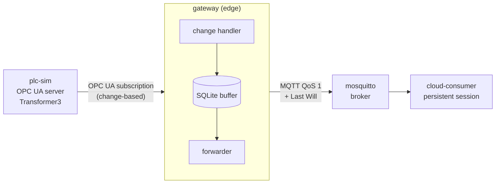

# Edge-to-Cloud Lab: OPC UA → MQTT gateway

A small, runnable model of an industrial edge-to-cloud data path: a simulated PLC
exposes a power transformer over **OPC UA**, an **edge gateway** subscribes to it and forwards
every change over **MQTT**, and a **cloud consumer** receives it. The gateway buffers to disk,
so no data is lost while the broker or the uplink is down.

I built it as a hands-on lab to learn OPC UA and MQTT and how an edge-to-cloud deployment
fails and recovers. It is not production software: this is a lab setup with no TLS or authentication.



## Quick start

Requires Docker.

```bash
docker compose up -d --build
docker logs -f cloud-consumer
```

```
[cloud] site/ludvika/station1/gateway/status             online  [retained]
[cloud] site/ludvika/station1/gateway/opcua              connected  [retained]
[cloud] site/ludvika/station1/transformer3/temperature      64.94  quality=Good  source_ts=2026-10-27T21:27:01.163814+00:00
[cloud] site/ludvika/station1/transformer3/oil_level        82.79  quality=Good  source_ts=2026-10-27T21:27:01.164082+00:00
```

## Failure drills

The point of the lab is to break it on purpose and watch it recover.

| Drill | Command | What you should see |
|---|---|---|
| Broker / uplink down | `docker stop mosquitto`, wait, `docker start mosquitto` | Gateway logs `buffering to disk` and a growing count; on reconnect the backlog drains in order. Verified: after a ~25 s outage every 1 s sample arrived, with no gaps. |
| PLC down | `docker stop plc-sim`, then `docker start plc-sim` | `gateway/opcua` flips to `disconnected`, the gateway retries every 5 s and re-subscribes on its own. |
| Gateway crash | `docker kill gateway` | The broker publishes the gateway's Last Will: `gateway/status = offline`. |
| Gateway restart with backlog | stop `mosquitto`, then `docker restart gateway`, then start `mosquitto` | Buffered messages survive the restart (SQLite on a volume). |
| Consumer down | `docker stop cloud-consumer`, then start it again | Messages published meanwhile are delivered after reconnect (persistent session, QoS 1). |

Useful while doing them: `docker logs -f gateway`, `docker logs -f mosquitto`.

## Design decisions

- **Change-based OPC UA subscription, not polling.** The server only sends values that changed,
  which matters when a controller exposes thousands of tags.
- **Browse instead of a hard-coded tag list.** The gateway forwards every variable under the
  configured object, so a new variable on the device needs no gateway change.
- **Write to disk first, then publish.** Every change goes into a SQLite FIFO; a row is deleted only
  after the broker's PUBACK. This survives broker outages *and* gateway restarts, unlike the MQTT
  client's in-memory queue. When the buffer is full the oldest data is dropped.
- **At-least-once delivery.** QoS 1 plus resend on timeout means a consumer can see a duplicate.
  Consumers should de-duplicate on `topic + source_ts`.
- **Device timestamps.** `source_ts` is set by the PLC at measurement time. `gateway_ts` is kept
  separately to measure latency and spot clock drift.
- **Quality travels with the value.** OPC UA status codes (`Good`, `Bad...`, `Uncertain...`) are
  forwarded so consumers can discard data from failed sensors.
- **Separate health topics.** `gateway/status` (Last Will, retained) answers "is the gateway alive?",
  `gateway/opcua` (retained) answers "can it reach the PLC?". Together they tell an operator which
  side of the gateway is broken.
- **Configured by environment.** One image for every site; `.env.example` is the per-site template.

## Topics and payload

```
site/ludvika/station1/transformer3/temperature
site/ludvika/station1/transformer3/oil_level
site/ludvika/station1/transformer3/tap_position
site/ludvika/station1/transformer3/breaker_closed
site/ludvika/station1/gateway/status      online | offline   (retained, Last Will)
site/ludvika/station1/gateway/opcua       connected | disconnected   (retained)
```

```json
{"value": 64.94, "quality": "Good", "source_ts": "2026-10-27T21:27:01.163814+00:00", "gateway_ts": "2026-10-27T21:27:01.170201+00:00"}
```

## Configuration

| Variable | Default | Meaning |
|---|---|---|
| `OPCUA_URL` | `opc.tcp://plc-sim:4840/ludvika/` | OPC UA endpoint of the device |
| `OPCUA_OBJECT` | `ns=2;s=Transformer3` | Object whose variables are forwarded |
| `OPCUA_PUBLISHING_INTERVAL_MS` | `500` | Subscription publishing interval |
| `MQTT_HOST` / `MQTT_PORT` | `mosquitto` / `1883` | Broker |
| `MQTT_CLIENT_ID` | `edge-gateway-1` | Must be unique per gateway |
| `TOPIC_PREFIX` | `site/ludvika/station1` | Root of all published topics |
| `BUFFER_MAX_MESSAGES` | `100000` | Disk buffer cap, oldest dropped first |

## Project layout

```
plc_simulator/   OPC UA server simulating a transformer (temperature, oil level, tap position, breaker)
gateway/         OPC UA client -> SQLite buffer -> MQTT publisher
cloud/           MQTT consumer with a persistent session
demos/           standalone MQTT lessons: retained messages, Last Will, QoS and persistent sessions
mosquitto/       broker configuration
tests/           unit tests for the buffer and payload mapping
docs/            my learning notes (Turkish)
```

## Running locally without Docker

```bash
python -m venv .venv && .venv/bin/pip install -r requirements-dev.txt   # Windows: .venv\Scripts\
docker compose up -d mosquitto
python plc_simulator/opcua_server.py
python -m gateway.main
python cloud/consumer.py
python -m pytest
```
